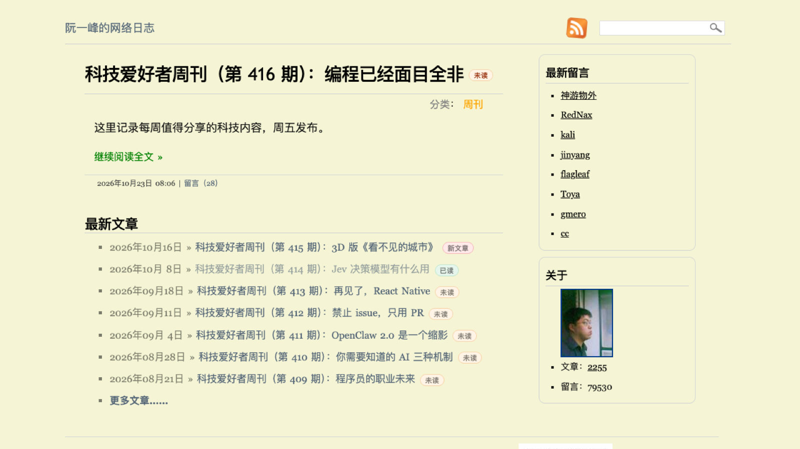
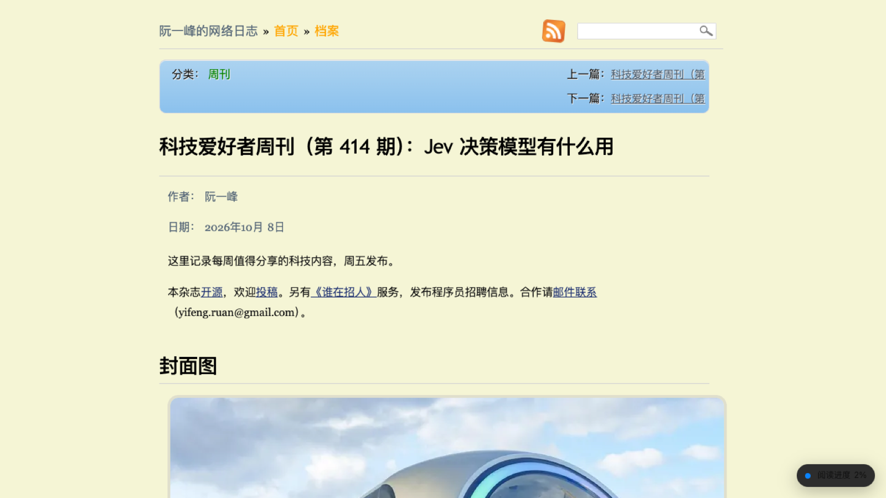
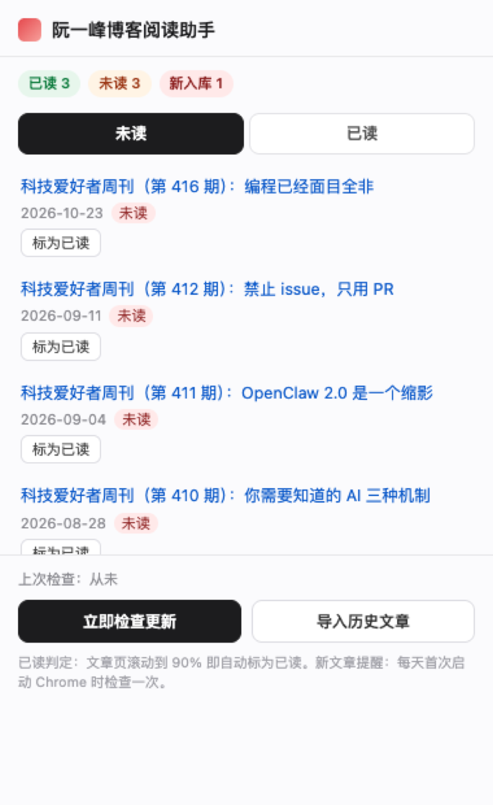
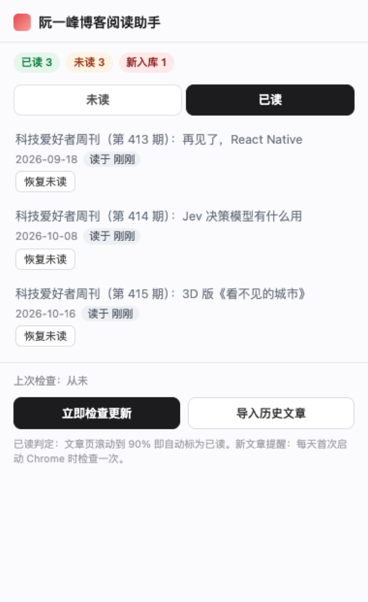

# 阮一峰博客阅读助手

> 在 [阮一峰的博客](https://www.ruanyifeng.com/blog/index.html) 上直接标出**每篇文章是否读过**，有新文章时**主动弹 Chrome 通知**。

一个纯本地、零依赖的 Chrome 扩展（Manifest V3）。不联网上报任何数据，所有阅读记录都存在你自己的浏览器里。



---

## 为什么做这个

阮一峰的《科技爱好者周刊》每周五更新，文章多、更新慢、经典文章散落在 2000+ 篇历史里。实际情况是：

- 打开首页，**分不清哪篇读过、哪篇没读**，经常点进同一篇看第二遍；
- 周刊不是每天发，**不做提醒就容易错过**，等到想起来已经堆了好几期；
- 想找以前读过的东西，只记得标题片段，没有任何「已读」线索可循。

所以做了这个扩展：把「已读/未读」直接画在站点上，把「更新提醒」交给 Chrome。

---

## 功能一览

### 1. 已读标记：直接标在网页上

在**首页正文、「最新文章」列表、存档页、按月页、分类页**的每一条文章后面，注入一枚状态徽标：


三种状态一眼可辨：

| 徽标 | 含义 |
|---|---|
| 🟢 `已读` | 读过。标题同时**变淡并加 ✓**，扫一眼就能看出还剩哪几篇 |
| 🟠 `未读` | 库里存在、但还没读 |
| 🔴 `新文章` | 上次检查时发现的新文章，附带左侧红色竖条 |

### 2. 自动判定已读：读到 90% 算读完

不需要任何点击。打开文章页，右下角会浮出一个实时的阅读进度：



- 进度按「当前滚动位置 / 页面总高」实时计算；
- **滚到 90% 且页面在前台活跃超过 1.5 秒**，自动标为已读，右下角变绿 `✓ 已标记为已读`；
- 只读到一半、或页面在后台搁着，都不会被误判；
- 短于一屏的文章直接算读完；
- 点击进度条可以一键跳到页底。

### 3. 更新提醒：每天第一次开 Chrome 自动查

- 每天**第一次启动 Chrome** 时自动检查一次（当天已查过就跳过，用 `chrome.alarms` + `onStartup` 双保险）；
- 发现新文章 → 系统通知「📚 阮一峰更新了 + 标题」+ 工具栏红色 `NEW` 角标，点通知直接打开文章；
- 判断依据是 **首页最新一篇的 id 与上次记录不同**，不会重复报警；
- 想立刻查：点工具栏图标 →「立即检查更新」。

---

## 弹窗：已读 / 未读一览

点工具栏图标，是一个本地清单：

<p align="left">
  
  
</p>

- 顶部统计：已读 / 未读 / 新入库数量；
- 「未读」「已读」两个标签页，各自按时间倒序列出；
- 每条可一键「标为已读 / 恢复未读」，改完当前网页的徽标立刻同步；
- 底部两个按钮：「立即检查更新」「导入历史文章」。

---

## 安装

扩展未上架 Chrome 应用商店，用**开发者模式加载**即可，30 秒：

1. 下载本仓库（`Code` → `Download ZIP`），解压。
2. 打开 Chrome，地址栏输入 `chrome://extensions/`。
3. 右上角打开 **「开发者模式」** 开关。
4. 点左上角 **「加载已解压的扩展程序」** → 选中解压目录里的 **`dist/`** 文件夹。
5. 出现「阮一峰博客阅读助手」卡片即安装成功。

> 也可以 `git clone` 后直接选 `dist/`，或按下面「从源码构建」自己打一份。
> ⚠️ 装好别移动/删除 `dist/`，Chrome 每次启动都从该路径读取。

装好后建议：点 Chrome 右上角拼图图标 → 把「阮一峰博客阅读助手」**固定到工具栏**。

**第一次用，先做一步**：点工具栏图标 → **「导入历史文章」**。
扩展只能记录「装好之后」的阅读行为，不会知道你以前读过什么；导入会把站点上能抓到的全部文章（当前 1200+ 篇）建进档案，之后你读一篇就自动勾掉一篇。

---

## 数据与隐私

- 存储位置：浏览器内置 **IndexedDB**（库名 `ruanyf-reader`），存在本机，随浏览器配置走；
- 记录字段：`id / url / title / published / status(read|unread|new) / readAt / readProgress`；
- 权限只申请必要项：
  - `storage`、`unlimitedStorage`：本地存阅读记录；
  - `alarms`、`notifications`：每日检查与更新提醒；
  - 站点权限仅 `https://www.ruanyifeng.com/*`；
  - **没有任何遥测、上报、第三方请求**；
- 卸载扩展 = 清空记录。

---

## 技术实现

纯前端、无框架。源码为原生 ES Module，用 esbuild 打包成 MV3 产物。

```
src/manifest.json        MV3 清单（background=ESM service worker）
src/background-parts.js  后台：每日检查、通知、IndexedDB 读写、消息路由
src/content.js           内容脚本：页面徽标注入、阅读进度与自动标已读
src/popup.html / .js     工具栏弹窗：未读/已读清单、手动操作
src/common.js            URL 归一化、文章解析（SW 内用轻量正则解析，无 DOM）
src/db.js                IndexedDB 封装（基于 idb）
scripts/build.mjs        esbuild 打包脚本
scripts/make_icons.py    图标生成（Pillow，不占仓库体积）
scripts/e2e*.mjs         Playwright 端到端测试
```

几个关键设计取舍：

- **写入统一走后台。** MV3 里 content script 运行在页面的存储分区，它写的 IndexedDB 和扩展页面看到的**不是同一个库**。所以 content script 只读 DOM、通过 `chrome.runtime.sendMessage` 把结果交给后台写库，弹窗也从后台读——三处永远一致。
- **service worker 里不能用 `DOMParser`。** 抓取首页/存档页后，用专门写的轻量 HTML 解析函数提取文章 id、标题、精确发布时间（`<abbr class="published" title="ISO">`）。
- **判定不靠本地时间。** 新文章识别基于文章 URL 里的稳定 id（`YYYY/MM/slug`），不依赖标题变化或服务器时钟。

### 从源码构建

```bash
npm install
npm run build      # 产物输出到 dist/
```

### 测试

端到端测试用 Playwright 驱动真实的 Chrome for Testing，**加载真实扩展并访问真实站点**：

```bash
node scripts/e2e.mjs         # 12 项：注入/徽标/已读落库/检查更新/导入历史/弹窗渲染
node scripts/e2e-alert.mjs   # 9 项：新文章识别、通知、去重、90% 阈值
```

覆盖的关键断言：每条目只有一个徽标（防重复注入）、只读到一半不标已读而跨过 90% 会标、已读状态通过弹窗的 `LIST_ARTICLES` 回读验证、同一天重复检查不重复报警。

---

## 已知限制

- **无法回溯安装前的阅读历史**。只能靠「导入历史」建档 + 之后的自动记录。
- 站点没有全站文章列表接口，历史导入靠逐层爬列表页（默认上限 80 页），更早的深页需要时会继续翻。
- 站点前面有 Cloudflare，**短时间大量抓取会触发限流**（Error 1015，几分钟到几十分钟自动解除）。这是站点防护，不是扩展 bug。
- 只支持 Chrome / Edge 等 Chromium 内核浏览器（MV3），不支持 Firefox / Safari。
- 选择器以阮一峰博客现版式为准；若站点改版，需要相应更新。

---

## 许可

MIT
